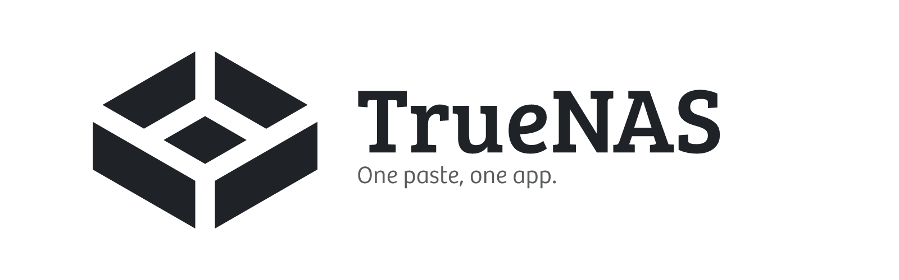
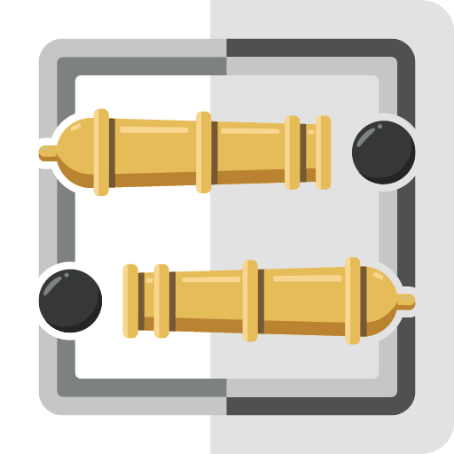
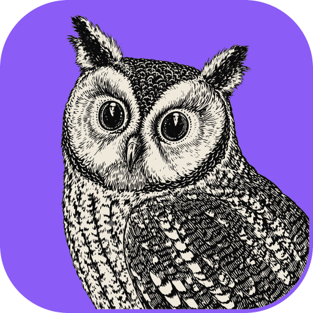
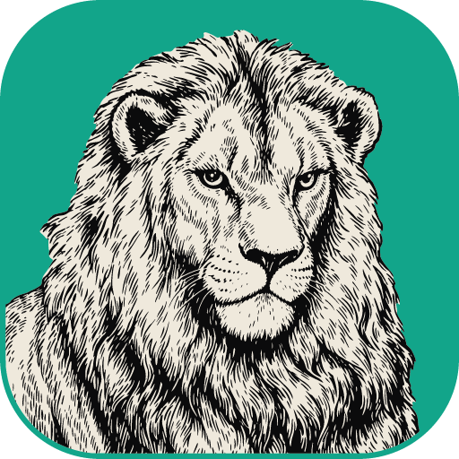
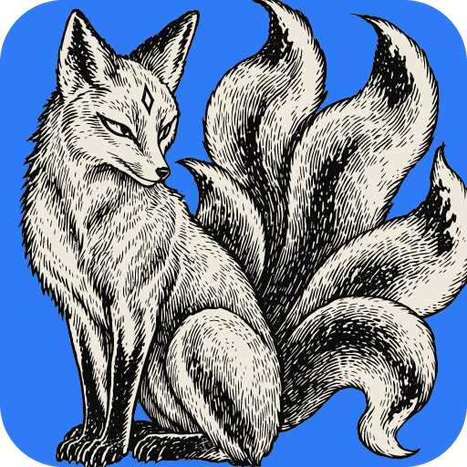
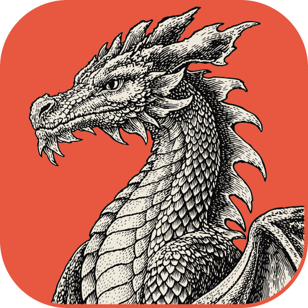
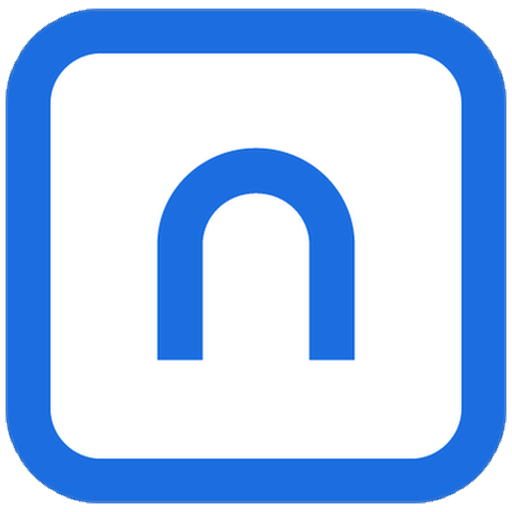

<p align="center">
  <picture>
    <source media="(prefers-color-scheme: dark)" srcset=".github/assets/banner-dark.png">
    
  </picture>
</p>

<p align="center">
  <a href="https://github.com/junkerderprovinz/truenas-apps/actions/workflows/generate.yml"></a>&nbsp;
  <a href="#apps"></a>&nbsp;
  <a href="https://github.com/junkerderprovinz/truenas-apps/commits/main"></a>&nbsp;
  <a href="https://www.truenas.com/truenas-community-edition/"></a>&nbsp;
  <a href="LICENSE"></a>
</p>

<p align="center">
Ready-made app files for <a href="https://www.truenas.com/truenas-community-edition/">TrueNAS</a> with junkerderprovinz's containers, grouped like the profile: <b>Apps</b> (my own software), <b>Images</b> (my own image builds of third-party apps) and <b>Wrappers</b> (thin templates over an upstream image). TrueNAS installs apps from its own catalog only, so each app here is one file to paste under <b>Install via YAML</b>.
</p>


<!-- apps:start -->
## Apps

*My own software, built and published by junkerderprovinz. Full docs live in each app's own repository.*

<a id="arrowloop"></a>

<a href="https://github.com/junkerderprovinz/arrowloop#readme"></a>
<a href="apps/arrowloop.yaml"></a>

**ArrowLoop**<br>
Two-way file sync that shows you the plan before it touches a file, sends deletions to a trash and stops a run that would delete too much.

<br clear="all">

<a id="cannoncommander"></a>

<a href="https://github.com/junkerderprovinz/cannoncommander#readme"></a>
<a href="apps/cannoncommander.yaml"></a>

**CannonCommander**<br>
The most beautiful file manager you will ever run, and the only one you need: two panels, F5 to copy, jobs in the background and a trash for second thoughts.

<br clear="all">

<a id="castleparcel"></a>

<a href="https://github.com/junkerderprovinz/castleparcel#readme"></a>
<a href="apps/castleparcel.yaml"></a>

**CastleParcel**<br>
The big-file transfer site you know, on your own server and sealed: encrypted in your browser, with an optional owner sign-in, self-expiring share links, file requests and notes. Formerly featherdrop.

<br clear="all">

<a id="knightloader"></a>

<a href="https://github.com/junkerderprovinz/knightloader#readme"></a>
<a href="apps/knightloader.yaml"></a>

**KnightLoader**<br>
Self-hosted download manager for hosters, debrid, torrents, Usenet and video, with an Android app and a browser extension.

<br clear="all">

<a id="trickwork"></a>

<a href="https://github.com/junkerderprovinz/trickwork#readme"></a>
<a href="apps/trickwork.yaml"></a>

**TrickWork**<br>
Turns images into proportional-font-aware ASCII art - a rebuild of ASCII Gen 2, picking characters by real ink coverage, not brightness.

<br clear="all">


## Images

*My own custom image builds of third-party apps. Full docs in each app's own repository.*

<a id="cadcraft"></a>

<a href="https://github.com/junkerderprovinz/artcraft-apps#cadcraft"></a>
<a href="apps/cadcraft.yaml"></a>

**CADCraft**<br>
CADCraft on a Selkies web desktop: 2D drafting with layers, blocks and dimensions, and DXF and DWG files, all in the browser.

<br clear="all">

<a id="deckcraft"></a>

<a href="https://github.com/junkerderprovinz/artcraft-apps#deckcraft"></a>
<a href="apps/deckcraft.yaml"></a>

**DeckCraft**<br>
DeckCraft on a Selkies web desktop, for building and presenting PowerPoint decks from any browser.

<br clear="all">

<a id="designcraft"></a>

<a href="https://github.com/junkerderprovinz/artcraft-apps#designcraft"></a>
<a href="apps/designcraft.yaml"></a>

**DesignCraft**<br>
DesignCraft on a Selkies web desktop: lay out magazines and flyers in the browser and export print-ready PDFs.

<br clear="all">

<a id="effectcraft"></a>

<a href="https://github.com/junkerderprovinz/artcraft-apps#effectcraft"></a>
<a href="apps/effectcraft.yaml"></a>

**EffectCraft**<br>
EffectCraft on a Selkies web desktop, for motion graphics with compositions, keyframes and effects in the browser.

<br clear="all">

<a id="euro-office"></a>

<a href="https://github.com/junkerderprovinz/euro-office#readme"></a>
<a href="apps/euro-office.yaml"></a>

**Euro Office**<br>
Sovereign, OnlyOffice-compatible document server for browser editing of Office and OpenDocument files, wired into OpenCloud over WOPI.

<br clear="all">

<a id="excalidraw"></a>

<a href="https://github.com/junkerderprovinz/excalidraw#readme"></a>
<a href="apps/excalidraw.yaml"></a>

**Excalidraw**<br>
The hand-drawn whiteboard, built so it keeps to itself: shared links, live collaboration, the session scene and even the fonts all come from your own server.

<br clear="all">

<a id="figcraft"></a>

<a href="https://github.com/junkerderprovinz/artcraft-apps#figcraft"></a>
<a href="apps/figcraft.yaml"></a>

**FigCraft**<br>
FigCraft on a Selkies web desktop: design interfaces with frames and components and click through prototypes in the browser.

<br clear="all">

<a id="filebot"></a>

<a href="https://github.com/junkerderprovinz/filebot#readme"></a>
<a href="apps/filebot.yaml"></a>

**FileBot**<br>
The FileBot media renamer in your browser on a fast Selkies web desktop, dark from the first start. Bring your own FileBot license.

<br clear="all">

<a id="filmcraft"></a>

<a href="https://github.com/junkerderprovinz/artcraft-apps#filmcraft"></a>
<a href="apps/filmcraft.yaml"></a>

**FilmCraft**<br>
FilmCraft on a Selkies web desktop, a nonlinear video editor that cuts the footage on your array from any browser.

<br clear="all">

<a id="garage"></a>

<a href="https://github.com/junkerderprovinz/garage#readme"></a>
<a href="apps/garage.yaml"></a>

**Garage**<br>
Garage's S3-compatible object store and its web admin panel in one container, with the single-node layout and S3 keys created automatically.

<br clear="all">

<a id="gridcraft"></a>

<a href="https://github.com/junkerderprovinz/artcraft-apps#gridcraft"></a>
<a href="apps/gridcraft.yaml"></a>

**GridCraft**<br>
GridCraft on a Selkies web desktop: a spreadsheet with formulas and charts that opens and saves Excel workbooks.

<br clear="all">

<a id="handbrake"></a>

<a href="https://github.com/junkerderprovinz/handbrake#readme"></a>
<a href="apps/handbrake.yaml"></a>

**HandBrake**<br>
HandBrake's full GUI on a fast Selkies web desktop, GPU-accelerated on NVIDIA, Intel and AMD, with a watch folder that converts on its own.

<br clear="all">

<a id="jdownloader"></a>

<a href="https://github.com/junkerderprovinz/jdownloader#readme"></a>
<a href="apps/jdownloader.yaml"></a>

**JDownloader**<br>
JDownloader 2 with a complete, sleek dark UI out of the box, on a fast Selkies web desktop in your browser. No VNC client, no install.

<br clear="all">

<a id="krusader"></a>

<a href="https://github.com/junkerderprovinz/krusader#readme"></a>
<a href="apps/krusader.yaml"></a>

**Krusader**<br>
Twin-pane KDE file manager with a native dark theme on a fast Selkies web desktop, with Kate, krename and RAR built in.

<br clear="all">

<a id="lightcraft"></a>

<a href="https://github.com/junkerderprovinz/artcraft-apps#lightcraft"></a>
<a href="apps/lightcraft.yaml"></a>

**LightCraft**<br>
LightCraft on a Selkies web desktop, a photo library and raw developer that sits right next to the photos on your array.

<br clear="all">

<a id="opencloud"></a>

<a href="https://github.com/junkerderprovinz/opencloud#readme"></a>
<a href="apps/opencloud.yaml"></a>

**OpenCloud**<br>
One-click OpenCloud file sync &amp; share: auto-runs init, heals appdata permissions and honours PUID/PGID.

<br clear="all">

<a id="pdfcraft"></a>

<a href="https://github.com/junkerderprovinz/artcraft-apps#pdfcraft"></a>
<a href="apps/pdfcraft.yaml"></a>

**PdfCraft**<br>
PdfCraft on a Selkies web desktop, for reading, editing, signing and running OCR on PDFs in the browser.

<br clear="all">

<a id="photocraft"></a>

<a href="https://github.com/junkerderprovinz/artcraft-apps#photocraft"></a>
<a href="apps/photocraft.yaml"></a>

**PhotoCraft**<br>
PhotoCraft on a Selkies web desktop: a layered photo editor in the browser that opens PSD, Krita and Affinity files.

<br clear="all">

<a id="prusaslicer"></a>

<a href="https://github.com/junkerderprovinz/prusaslicer#readme"></a>
<a href="apps/prusaslicer.yaml"></a>

**PrusaSlicer**<br>
The PrusaSlicer 3D-printing slicer in your browser on a fast Selkies web desktop: slice and export G-code, no VNC client (amd64 + arm64).

<br clear="all">

<a id="rustdesk"></a>

<a href="https://github.com/junkerderprovinz/rustdesk#readme"></a>
<a href="apps/rustdesk.yaml"></a>

**RustDesk**<br>
Your own RustDesk server with a web console, accounts, an address book on every client and devices that can change their ID.

<br clear="all">

<a id="seafile"></a>

<a href="https://github.com/junkerderprovinz/seafile#readme"></a>
<a href="apps/seafile.yaml"></a>

**Seafile**<br>
The official Seafile server from one template, with its secrets generated on first start and MariaDB, Redis and the notification server built in on request.

<br clear="all">

<a id="securo"></a>

<a href="https://github.com/junkerderprovinz/securo#readme"></a>
<a href="apps/securo.yaml"></a>

**Securo**<br>
The Securo finance manager with its worker and scheduler in one container, on your own PostgreSQL and Redis or on built-in ones.

<br clear="all">

<a id="soundcraft"></a>

<a href="https://github.com/junkerderprovinz/artcraft-apps#soundcraft"></a>
<a href="apps/soundcraft.yaml"></a>

**SoundCraft**<br>
SoundCraft on a Selkies web desktop, a multitrack audio workstation whose sound plays in the browser.

<br clear="all">

<a id="stellarium"></a>

<a href="https://github.com/junkerderprovinz/stellarium#readme"></a>
<a href="apps/stellarium.yaml"></a>

**Stellarium**<br>
The Stellarium planetarium in your browser on a fast Selkies web desktop: pan the sky, zoom a nebula, scrub through time, no VNC client.

<br clear="all">

<a id="vectorcraft"></a>

<a href="https://github.com/junkerderprovinz/artcraft-apps#vectorcraft"></a>
<a href="apps/vectorcraft.yaml"></a>

**VectorCraft**<br>
VectorCraft on a Selkies web desktop: vector illustration with paths and type, SVG and PDF in and out.

<br clear="all">

<a id="wordcraft"></a>

<a href="https://github.com/junkerderprovinz/artcraft-apps#wordcraft"></a>
<a href="apps/wordcraft.yaml"></a>

**WordCraft**<br>
WordCraft on a Selkies web desktop, a word processor in the browser that opens and saves Word documents.

<br clear="all">


## Wrappers

*Thin templates over a third-party upstream image (no custom build). Full docs in each app's folder below.*

<a id="couchdb"></a>

<a href="https://github.com/junkerderprovinz/unraid-apps/blob/main/couchdb/README.md"></a>
<a href="apps/couchdb.yaml"></a>

**CouchDB**<br>
The HTTP/JSON document database behind Obsidian LiveSync, on the official 3.x image with data, config and CORS mapped so they survive a recreate or update.

<br clear="all">

<a id="github-runner"></a>

<a href="https://github.com/junkerderprovinz/github-runner#readme"></a>
<a href="apps/github-runner.yaml"></a>

**GitHub-Runner**<br>
Self-hosted GitHub Actions runners for several repositories of a personal account in one container, removed from GitHub again when it stops.

<br clear="all">

<a id="pocket-id"></a>

<a href="https://github.com/junkerderprovinz/unraid-apps/blob/main/pocket-id/README.md"></a>
<a href="apps/pocket-id.yaml"></a>

**Pocket ID**<br>
Passkey login for every app on your server that speaks OpenID Connect, with users, groups and an audit log, on SQLite or PostgreSQL.

<br clear="all">

<a id="rustfs"></a>

<a href="https://github.com/junkerderprovinz/unraid-apps/blob/main/rustfs/README.md"></a>
<a href="apps/rustfs.yaml"></a>

**RustFS**<br>
An S3 object store in Rust, with the two fixes it needs to run on Unraid at all. Pre-release: every version so far is a release candidate.

<br clear="all">

<a id="seaweedfs"></a>

<a href="https://github.com/junkerderprovinz/unraid-apps/blob/main/seaweedfs/README.md"></a>
<a href="apps/seaweedfs.yaml"></a>

**SeaweedFS**<br>
Fast, S3-API-compatible object store on the official image, the actively-maintained alternative now that MinIO's open edition is done.

<br clear="all">

<a id="silo"></a>

<a href="https://github.com/junkerderprovinz/unraid-apps/blob/main/silo/README.md"></a>
<a href="apps/silo.yaml"></a>

**Silo**<br>
MinIO, still maintained: PGSTY's fork of the open-source server, with the full web console. It reads an existing MinIO data folder as it is.

<br clear="all">

<a id="standardnotes-webui"></a>

<a href="https://github.com/junkerderprovinz/unraid-apps/blob/main/standardnotes-webui/README.md"></a>
<a href="apps/standardnotes-webui.yaml"></a>

**Standard Notes Web UI**<br>
The official Standard Notes web client, self-hosted next to your own sync server for end-to-end encrypted notes in the browser.

<br clear="all">

<a id="versitygw"></a>

<a href="https://github.com/junkerderprovinz/unraid-apps/blob/main/versitygw/README.md"></a>
<a href="apps/versitygw.yaml"></a>

**VersityGW**<br>
An S3 API in front of a share you already have: top-level folders become buckets, and every file stays readable over SMB and NFS at the same time.

<br clear="all">
<!-- apps:end -->


## Install

1. Open the app's file with the **TrueNAS YAML** button on its card and copy it.
2. In TrueNAS, open **Apps**, then **Discover Apps**, and choose **Install via YAML** in the menu beside **Custom App**.
3. Give the app the name the file's first lines suggest and paste the file. Replace `tank` with the name of your pool, fill in every value marked `required` and save.

TrueNAS pulls the image and starts the app. The file lists the ports its web page and services listen on.

A few apps share a port: CastleParcel and Securo use 3000, Excalidraw and GitHub Runner 8080, RustFS and Silo 9000 and 9001. To run both of a pair, change the number left of the colon for one of them.

Questions and bugs go to the issue tracker of the app's own repository, linked from **Repository & ReadMe** on its card.


## How these differ from the Unraid templates

The apps are built from the Unraid templates in [unraid-apps](https://github.com/junkerderprovinz/unraid-apps), through the same compose files the app repositories offer for other Docker hosts, with the changes TrueNAS needs:

- Appdata goes to `/mnt/tank/apps/<app>`. File managers, slicers and the web desktops see the whole pool, and downloads land in `/mnt/tank/downloads`.
- `PUID` and `PGID` are `568`, the user and group TrueNAS runs its own apps as.
- Each Selkies web desktop gets its own pair of ports, 32000 and up, so several of them fit on one TrueNAS.
- CannonCommander sees `/mnt` where it looks for Unraid's user shares, `/mnt/user`, and keeps the capabilities and `/dev/fuse` it needs for rclone's mounts. It runs without Docker's AppArmor profile, which would refuse those mounts. The Unraid state and flash folders are left out.
- A password or key that the Unraid template asks for at install time stays empty and is marked `required`.
- JuiceFS, ParleyPort and the apps that need a database next to them (Matrix, n8n, Claper) are not here yet.

To change an app, edit its template in unraid-apps, not the files in `apps/`, `.github/readme-icons/` or the app list in this README. A workflow here rebuilds them every night. To build them by hand:

```sh
python3 tools/generate.py ../unraid-apps
```

`apps.json` lists the apps. Per app it can set where a folder goes on the pool (`paths`) and where it shows up in the container (`targets`), give ports another host port (`ports`), leave a path out (`drop_paths`), set Docker's `security_opt` (`security_opt`), set variables (`env`), or read a template file with another name (`xml`).


## How AI is used here

One knight builds this, and AI is one of the tools I work with, the same way I work with an editor or a compiler. It helps me write code and documentation and it checks my work, and that saves me a good many evenings. It does not make the decisions, though. I read and understand everything before it ships, and if something here breaks, that is on me and not on the tool.

You do not have to take my word for it. The code is open and every release note is written by hand. The issue tracker shows how problems actually get handled, including the ones I got wrong the first time. If you find something that is not right, open an issue and I will look at it.

## Support

A one-knight job: I build them, keep them running, work through the issues and add what people ask for, until nothing is missing. They are free, with no accounts, no telemetry, no ads and no paid tier. No asterisk anywhere. Nothing readable ever leaves your own walls. Forged on evenings and weekends, with heart and stubbornness.

If one of these has earned a place on your server or computer, toss a coin to your knight: it helps cover the costs and keeps the project alive. It also makes this knight's heart beat a little faster. Three ways below, whichever suits you.

<p align="center">
  <a href="https://buymeacoffee.com/junkerderprovinz"></a>
  <a href="https://www.paypal.com/donate/?hosted_button_id=76FVV52TKXTUS"></a>
  <a href="https://junkerderprovinz.github.io/junkerderprovinz/"></a>
</p>
